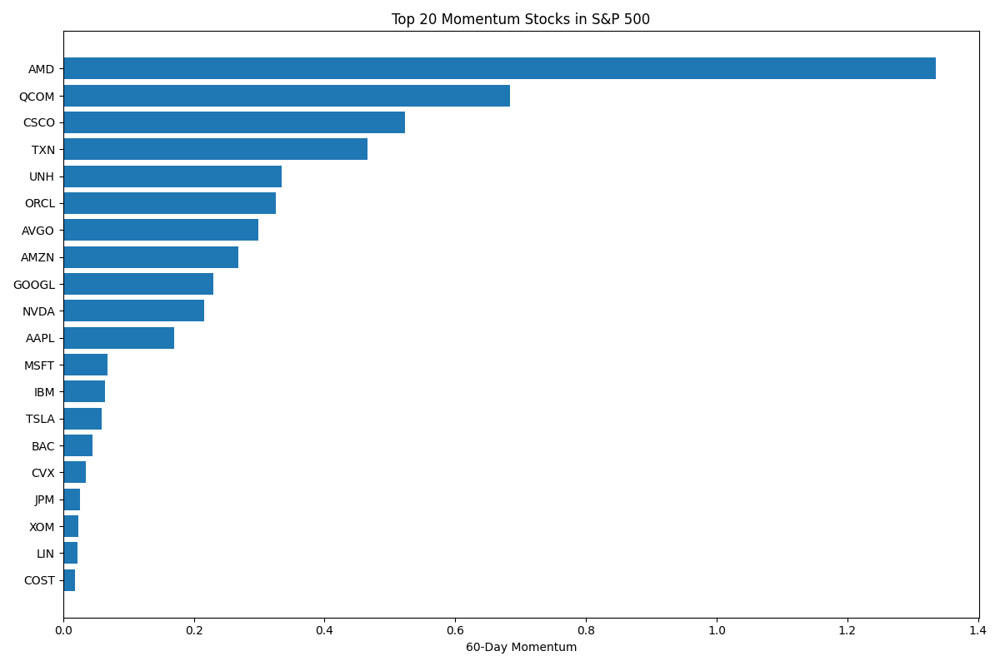

# US Large-Cap Momentum Screener

A Python-based quantitative research workflow for momentum factor analysis across U.S. large-cap equities.



## Overview

This project explores systematic equity screening methodologies commonly used in quantitative investing. Using Python and Jupyter Notebook, the workflow retrieves historical market data, calculates momentum signals, computes Sharpe Ratios, and ranks equities based on quantitative performance metrics.

The project was built as part of a self-directed effort to develop practical experience in factor research, data analysis, and AI-assisted quantitative workflows.

---

## Features

* Automated retrieval of U.S. large-cap equity price data using Yahoo Finance
* 60-day momentum factor calculation
* Risk-adjusted performance analysis using Sharpe Ratios
* Cross-sectional ranking of equities based on quantitative metrics
* Data visualization for top-performing momentum stocks
* CSV export of screening results

---

## Tech Stack

* Python
* pandas
* numpy
* matplotlib
* yfinance
* Jupyter Notebook

---

## Quantitative Concepts

* Momentum Factor Investing
* Cross-Sectional Equity Screening
* Risk-Adjusted Return Analysis
* Statistical Performance Measurement

---

## Sample Workflow

1. Retrieve historical equity price data
2. Calculate daily returns
3. Generate 60-day momentum signals
4. Compute annualized Sharpe Ratios
5. Rank equities by quantitative metrics
6. Visualize and export results

---

## Project Structure

```bash
momentum-factor-screener/
│
├── momentum_factor_analysis.ipynb
├── requirements.txt
├── README.md
└── output/
    ├── momentum_ranking.csv
    └── momentum_chart.png
```

---

## Motivation

This project was developed to strengthen practical quantitative research skills and explore AI-assisted financial research workflows using tools such as ChatGPT and Cursor AI.

Areas of focus include:

* systematic investing
* factor-based equity analysis
* workflow automation
* data-driven financial research

---

## Future Improvements

* Multi-factor ranking models
* Earnings surprise factor integration
* Portfolio backtesting framework
* Automated market alert system
* NLP-based earnings call analysis
